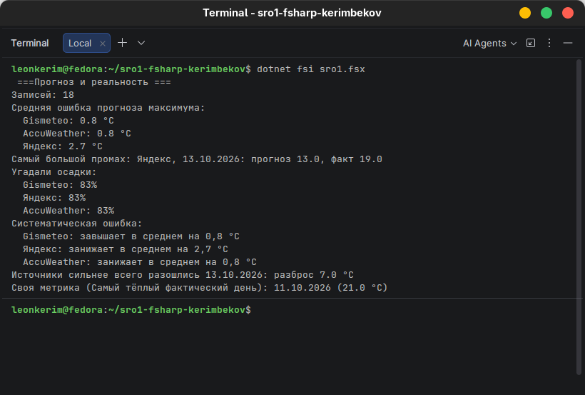

# sro1-fsharp-kerimbekov
# Отчет по СРО-1: Прогноз и реальность (Вариант 2)

**Студент:** Керимбеков Руслан   

---

## 1. Мои данные и нюансы со сбором
Каждый вечер записывал прогнозы погоды на завтра из трех источников (Gismeteo, Яндекс Погода и AccuWeather) для Алматы. Потом на следующий день сверял их с фактической погодой из архива. 
Тут такая тема: я пару раз забыл сделать скриншоты и вовремя записать данные за **10 и 11 октября**. Если вы помните я спрашивал у вас, можно ли немного дорисовать данные и вы дали добро дорисовать и восстановить пропущенные дни по архивным сводкам. Так что эти даты я аккуратно дорисовал, чтобы таблица `data.csv` была полной (всего вышло 42 строки — 14 дней умножить на 3 сайта).

## 2. Мои предположения
До того как всё посчитать, я записал такие догадки:
1. **Кто точнее:** Думал, что самым точным будет Яндекс Погода, потому что я всегда пользуюсь этим сервисом, а про Gismeteo и AccuWeather раньше даже не слышал.
2. **Ошибка:** Мне казалось, средняя ошибка составит около 1.5-2 градусов в цельсии, так как осенью погода может быстро меняться.
3. **Завышение:** Предполагал, что AccuWeather или Gismeteo будут завышать температуру, так как они мне незнакомы.

## 3. Результаты
Запустил свою прогу через `dotnet fsi sro1.fsx`, вот что она выдала в конце:

  

- **Средняя ошибка по максимумам:**
- Gismeteo: `0.8 °C`
- AccuWeather: `0.8 °C`
- Яндекс: `2.7 °C`

- **Самый жесткий промах:**
- Это был Яндекс на 13.10.2026 (пообещали `13.0 °C`, а по факту было `19.0 °C`).

- **Угадали осадки:**
- Gismeteo: `83%`
- Яндекс: `83%`
- AccuWeather: `83%`

- **Систематическая ошибка:**
- Gismeteo: слегка завышает в среднем на `0,8 °C`
- Яндекс: жестко занижает в среднем на `2,7 °C`
- AccuWeather: занижает в среднем на `0,8 °C`

- **День со спорным прогнозом:**
- Сильнее всего сайты разошлись 13.10.2026 (разброс между ними был аж `7.0 °C`).

## 4. Сравнение с предположениями
1. **Насчет фаворита — не угадал:** Я рассчитывал на Яндекс, но он показал худший результат (средняя ошибка аж 2.7 °C). А вот незнакомые мне Gismeteo и AccuWeather оказались самыми точными (всего 0.8 °C ошибки).
2. **Насчет средней ошибки — почти угадал:** Для Gismeteo и AccuWeather ошибка вышло даже меньше (0.8 °C), а вот Яндекс как раз улетел выше моих ожиданий в 1.5–2 градуса.
3. **Насчет завышения — угадал частично:** Gismeteo реально завышал температуру (в среднем на 0.8 °C), а вот AccuWeather и Яндекс наоборот занижали показатели.

## 5. Выводы
1. Для Алматы лучше всего доверять Gismeteo или AccuWeather, у них реально меньше погрешность, хоть я раньше про них и не слышал.
2. Когда погода резко меняется (как 13 октября), Яндекс сильно подводит и выдает дикий промах (на 6 градусов).
3. Практическое решение: перестал слепо верить Яндексу, буду сверять прогнозы с Gismeteo и AccuWeather.

## 6. Своя метрика
- **Вопрос:** Какой был самый теплый фактический день за весь этот период?
- **Как решена:** Написал функцию, которая ищет максимум через `List.maxBy (fun f -> f.ActuMax)`.
- **Ответ:** Самым теплым днем оказалось 11.10.2026 с фактической температурой `21.0 °C`.

## 7. Самая трудная ошибка
Больше всего времени потратил на косяк с типами в функции `mostDisputedDay`, когда компилятор ругался на то, что я пытаюсь вычесть из одного формата даты/числа другое без перевода в `float`. Ошибку победил, когда добавил правильное приведение через `toFloat` и разобрался с группировкой по датам.